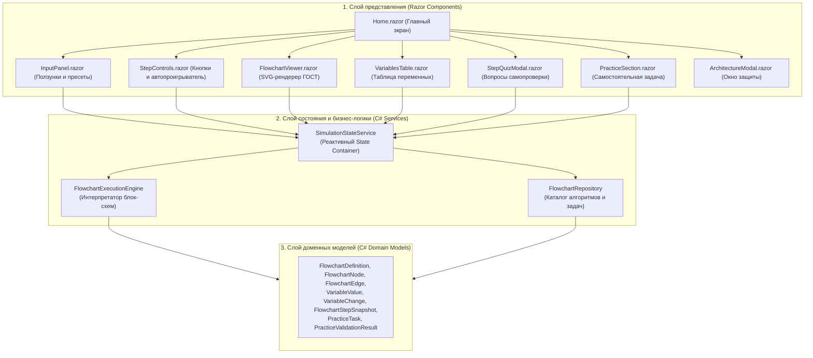
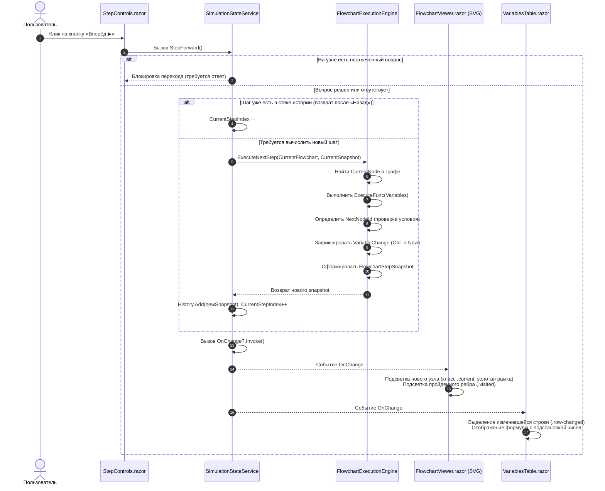

# Описание архитектуры приложения «Объясни задачу: Блок-схемы ветвления»

Настоящий документ содержит подробное описание архитектуры обучающего веб-приложения, разработанного в рамках индивидуального проекта на строго типизированном языке **C# (Blazor WebAssembly, .NET 9)**.

---

## 1. Общая архитектурная модель и разделение ответственности

Архитектура приложения построена по принципу **чистого разделения ответственности (Separation of Concerns, SoC)** с однонаправленным потоком данных (**Unidirectional Data Flow**). Приложение разделено на три независимых слоя:



### Назначение слоёв:
1. **Слой доменных моделей (`FlowchartExplainer/Models/`)**:
   - Чистые структуры данных C# (`record`, `readonly struct`, классы), не зависящие ни от Blazor, ни от браузера, ни от графики.
   - Определяет контракты узлов блок-схемы (`FlowchartNode`, `NodeType`), ребер со стрелками (`FlowchartEdge`, `Waypoint`), строго типизированных переменных (`VariableValue`, `VariableChange`) и снимков состояния (`FlowchartStepSnapshot`).
2. **Слой бизнес-логики и состояния (`FlowchartExplainer/Services/`)**:
   - `FlowchartExecutionEngine`: детерминированный движок пошаговой интерпретации блок-схемы. Выполняет расчёт формул, вычисляет предикаты условий ветвления («Да» / «Нет»), формирует историю изменений переменных и гарантирует корректность арифметики.
   - `SimulationStateService`: реактивное хранилище состояния сессии пользователя (Reactive State Container). Управляет текущим шагом, стеком истории (для возврата назад), активными вопросами, пользовательскими входными данными и автопроигрыванием по таймеру.
   - `FlowchartRepository`: статический репозиторий, инкапсулирующий три эталонные блок-схемы (Вводная, Основная, Особый случай) и самостоятельную задачу на подбор параметров.
3. **Слой представления (`FlowchartExplainer/Components/` и `Pages/`)**:
   - Razor-компоненты Blazor, отвечающие исключительно за рендеринг и взаимодействие с пользователем.
   - Включает векторный рендерер SVG, реактивную таблицу переменных, панель пошагового контроля, форму параметров и модальные окна.
   - Компоненты подписаны на событие `State.OnChange` и перерисовываются автоматически при изменении данных.

---

## 2. Где выполняются расчёты, хранится и изменяется состояние

### Хранение состояния (State Storage)
- Состояние сессии хранится в экземпляре класса `SimulationStateService`, зарегистрированном в DI-контейнере как `Scoped` (в рамках клиентской сессии Blazor WebAssembly):
  - `UserInputs`: текущие значения входных параметров алгоритма (`Dictionary<string, double>`).
  - `History`: хронологический стек снимков состояния (`List<FlowchartStepSnapshot>`). Каждый снимок фиксирует:
    - `CurrentNodeId` (какой блок сейчас активен);
    - `VisitedNodeIds` и `VisitedEdgeIds` (какой путь уже пройден);
    - `Variables` (значения всех переменных алгоритма на данном шаге);
    - `RecentChanges` (список переменных, изменившихся именно на этом шаге, с сохраненными старыми и новыми значениями);
    - `Explanation` и `FormulaApplied` (текстовое пояснение шага и строка формулы с подставленными числами).
  - `CurrentStepIndex`: индекс текущего отображаемого шага в стеке истории.
  - `ActiveQuestion`: состояние вопроса самопроверки (выбранный ответ, флаг правильности, текст подсказки).

### Выполнение расчётов (Calculation Logic)
- **Все расчёты полностью отделены от визуализации и выполняются в C#**:
  - Арифметические операции (сложение, умножение, вычисление процентов скидки, целочисленное деление `q = a / b` и остаток `r = a % b`) выполняются внутри лямбда-функций `ExecuteFunc` узлов и в `FlowchartExecutionEngine`.
  - Используется точная математика с контролируемым округлением (`Math.Round(..., 2)` для денежных величин и строгая целочисленная арифметика для остатков).
  - Никаких вычислений в CSS или шаблонах разметки не производится: в UI передаются готовые числовые значения и предварительно отформатированные строки формул (например, `total = 120 * 10 = 1200 руб.`).

### Поведение при смене данных и перезагрузке страницы
- **При изменении любого входного параметра** (через слайдер, числовое поле или кнопку пресета):
  - Метод `SetInput(name, value)` выполняет валидацию и ограничение значения в допустимых пределах (`Math.Clamp`).
  - Вызывается метод `ResetSimulation()`, который останавливает таймер автопроигрывания, очищает стек истории `History` и инициализирует первый шаг алгоритма с новыми значениями.
  - Разбор детерминированно сбрасывается к начальному узлу `n_start` / `m_start` / `s_start`.
- **Поведение при перезагрузке страницы (F5)**:
  - Поскольку Blazor WebAssembly выполняется полностью на стороне браузера (Client-Side SPA), при перезагрузке страницы приложение инициализируется из статического сборщика со значениями по умолчанию. Серверные сессии не требуются, что гарантирует полную автономность и возможность запуска в офлайн-режиме после первой загрузки (PWA-совместимость).

---

## 3. Движение данных: как действие пользователя проходит через приложение

Рассмотрим конкретный пример: пользователь нажимает кнопку **«Следующий шаг» (Вперёд)**.



### Подробное описание этапов:
1. **Событие UI**: Пользователь нажимает кнопку в компоненте `StepControls.razor`. Метод `@onclick="State.StepForward"` передает управление в `SimulationStateService`.
2. **Проверка инвариантов**: Сервис проверяет, не заблокирован ли переход контрольным вопросом (`CanStepForward`). Если вопрос активен и ещё не решён, переход игнорируется.
3. **Вычисление шага**:
   - Если пользователь ранее нажимал «Назад» и текущий индекс меньше длины истории, сервис просто инкрементирует `CurrentStepIndex` (мгновенный переход без повторных расчётов).
   - Если это новый шаг, вызывается метод `ExecuteNextStep` движка `FlowchartExecutionEngine`.
4. **Интерпретация узла**:
   - Движок определяет целевой блок блок-схемы.
   - Выполняются вычисления в C#. Например, на узле `m_cond_disc` проверяется условие `total > 1000`. При `total = 1200` условие возвращает `true`, и следующей ветвью назначается `m_disc_20` с меткой ветви «Да».
   - Фиксируются изменения переменных: старое значение, новое значение и строка примененной формулы с числовой подстановкой.
5. **Создание снимка**: Формируется новый неизменяемый объект `FlowchartStepSnapshot` и помещается в стек истории.
6. **Реактивное оповещение**: Сервис вызывает делегат `OnChange`. Все подписанные Razor-компоненты инициируют вызов `StateHasChanged()`.
7. **Перерисовка экрана**:
   - В `FlowchartViewer.razor` активный блок получает CSS-класс `.current` (золотое свечение и бейдж «ТЕКУЩИЙ»), пройденная стрелка окрашивается в синий цвет `.visited`.
   - В `VariablesTable.razor` обновляется таблица переменных: строка измененной переменной подсвечивается желтым градиентом, отображаются старое и новое значения (`0 -> 1200 руб.`), а в карточке пояснения выводится подробное описание действия.

---

## 4. Размещение частей в кодовой базе и обоснование структуры

Кодовая база организована по принципам чистого кода и доменно-ориентированного дизайна (DDD):

```
FlowchartExplainer/
├── Models/                     # ДОМЕННЫЙ СЛОЙ (МОДЕЛИ)
│   ├── NodeType.cs             # Типы блоков по ГОСТ (Start, End, Input, Output, Process, Condition)
│   ├── Waypoint.cs             # Координаты излома стрелок для ортогонального построения связей
│   ├── FlowchartEdge.cs        # Направленные связи между блоками, метки «Да» и «Нет»
│   ├── FlowchartNode.cs        # Узлы графа блок-схемы (геометрия, текст, вычисления)
│   ├── FlowchartDefinition.cs  # Полная структура алгоритма (входы, узлы, ребра, viewBox)
│   ├── VariableValue.cs        # Строго типизированное значение переменной (число, строка, bool)
│   ├── VariableChange.cs       # Фиксация дельты изменения переменной (OldValue -> NewValue)
│   ├── ExecutionState.cs       # Снимок состояния трассировки и вопросы самопроверки
│   ├── StepQuestion.cs         # Контрольный вопрос на шаге алгоритма
│   └── PracticeTask.cs         # Модель задачи самостоятельного подбора параметров (Тип 2)
│
├── Services/                   # СЛОЙ СЕРВИСОВ И БИЗНЕС-ЛОГИКИ
│   ├── FlowchartExecutionEngine.cs # Интерпретатор блок-схем без внешних зависимостей
│   ├── SimulationStateService.cs   # Реактивный контейнер состояния пользовательской сессии
│   └── FlowchartRepository.cs      # Каталог трёх блок-схем и самостоятельной задачи
│
├── Components/                 # СЛОЙ ПРЕДСТАВЛЕНИЯ (BLAZOR RAZOR)
│   ├── FlowchartViewer.razor   # Векторный интерактивный SVG-рендерер блок-схемы
│   ├── VariablesTable.razor    # Таблица переменных (память) с подстановкой формул
│   ├── StepControls.razor      # Кнопки «Вперёд», «Назад», «Сначала», автопроигрыватель
│   ├── StepQuizModal.razor     # Модальные вопросы для проверки понимания внутри шагов
│   ├── InputPanel.razor        # Форма ввода параметров со слайдерами и быстрыми пресетами
│   ├── PracticeSection.razor   # Интерактивный тренажер задачи Типа 2 с анализом ошибок
│   └── ArchitectureModal.razor # Интерактивная памятка по архитектуре для защиты проекта
│
├── Pages/
│   └── Home.razor              # Главная страница (композиция компонентов интерфейса)
│
├── Layout/
│   └── MainLayout.razor        # Каркас приложения, навигационные вкладки и шапка
│
└── wwwroot/
    ├── css/app.css             # Адаптивные стили (CSS Grid, Flexbox, анимации)
    └── index.html              # HTML5 точка входа Blazor WebAssembly
```

### Почему проект организован именно так:
1. **Изоляция расчётов**: Классы `FlowchartExecutionEngine` и `FlowchartRepository` не содержат ни единой ссылки на интерфейс (`Microsoft.AspNetCore.Components`). Это позволило протестировать их в проекте `FlowchartExplainer.Tests` обычными быстрыми xUnit-тестами.
2. **Переиспользуемость компонентов**: Компоненты `FlowchartViewer`, `VariablesTable` и `InputPanel` автономны и слабо связаны друг с другом — они взаимодействуют только через фасад `SimulationStateService`.
3. **Безопасность типов**: `VariableValue` реализован как легковесный `readonly struct`, что защищает от ошибок `NullReferenceException` и гарантирует единообразное форматирование чисел и булевых значений.

---

## 5. Демонстрация на защите проекта

Для успешной защиты проекта (40% итоговой оценки) подготовлены следующие демонстрационные сценарии:
1. **Объяснение на примере действия пользователя**:
   - На шаге узла скидки `m_cond_disc` показать, как введенные параметры (`price=120`, `qty=10`) превращаются в `total = 1200`, как движок сравнивает `1200 > 1000` и переходит по ветви «Да» к блоку `m_disc_20`.
   - Показать в коде файл `FlowchartRepository.cs` (строка с условием `total > 1000`) и метод `ExecuteNextStep` в `FlowchartExecutionEngine.cs`.
2. **Выполнение согласованного изменения кода**:
   - *Пример изменения*: изменить порог предоставления скидки с `1000` на `1500` руб. или изменить процент скидки с `20%` на `25%`.
   - Показать, что изменение делается ровно в одном месте в `FlowchartRepository.cs`, после чего интерфейс и логика проверки автоматически подхватывают новые правила.
